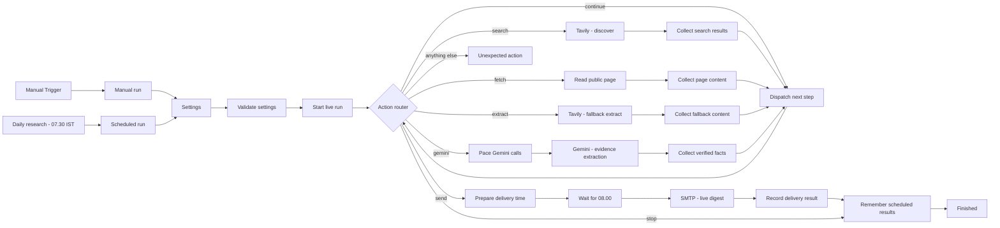

# Hackathon Radar

An [n8n](https://n8n.io) workflow that finds open AI, software, automation and data hackathons for people in India (in person or online worldwide), checks each one against its source page, and emails a daily digest.

Everything below is taken from `Hackathon Radar.json`. If you change the workflow, update this file too.

## Contents

- [What you get](#what-you-get)
- [Requirements](#requirements)
- [Credentials](#credentials)
- [Setup](#setup)
- [Settings](#settings)
- [How a run works](#how-a-run-works)
- [Node reference](#node-reference)
- [Research pipeline](#research-pipeline)
- [Verification rules](#verification-rules)
- [The email](#the-email)
- [Manual vs scheduled runs](#manual-vs-scheduled-runs)
- [Built-in limits](#built-in-limits)
- [Troubleshooting](#troubleshooting)
- [Offline check](#offline-check)
- [Repository files](#repository-files)

## What you get

A daily email titled `Hackathon Radar | N new · N updates · N closing soon · N to check` with these sections:

| Section | Contents |
|---|---|
| **New on your radar** | Open events where every key fact was confirmed by a verbatim quote from the source page (up to 10) |
| **What changed** | Events emailed before whose dates, requirements, eligibility, benefits or status changed, or that have closed |
| **Closing soon** | Reminders 7 days and 2 days before a registration or submission deadline |
| **Worth checking** | Promising events with at least one unconfirmed fact. Each card lists what to check (up to 10) |
| **Pages not verified** | Pages the AI could not classify after retries |

Each card shows format, location, registration and submission deadlines, who can enter, fees, prizes, team size, final round or travel, benefits, why the event was picked, and a link to the official page.

## Requirements

- An n8n instance. The Code nodes use `$getWorkflowStaticData`, `$execution` and `$('Node')` lookups, so self-hosted n8n or n8n Cloud both work.
- A [Tavily](https://tavily.com) API key (web search plus backup page reading).
- A [Google Gemini API](https://ai.google.dev) key with access to the configured model (default `gemini-3.5-flash-lite`).
- An SMTP account that may send as `fromEmail`. For Gmail, use an app password.

The Devpost and Unstop feeds and ordinary page reads are public and need no credentials.

## Credentials

Create these three credentials in n8n (**Credentials → Add credential**). Assign them to the nodes listed. The names are the ones in the JSON; you can use other names, but then re-select them on each node after import.

| Credential name in JSON | n8n credential type | Fields | Used by |
|---|---|---|---|
| `Tavily Header Auth` | Header Auth | **Name:** `Authorization`<br>**Value:** `Bearer <your Tavily API key>` | `Tavily - discover`, `Tavily - fallback extract` |
| `Gemini Header Auth` | Header Auth | **Name:** `x-goog-api-key`<br>**Value:** `<your Gemini API key>` | `Gemini - evidence extraction` |
| `SMTP` | SMTP | **User**, **Password**, **Host**, **Port**, **SSL/TLS**<br>Gmail: host `smtp.gmail.com`, port `465`, SSL on, an [app password](https://myaccount.google.com/apppasswords) | `SMTP - live digest` |

> Never commit API keys or passwords to this repository. The JSON stores only each credential's n8n ID and name; the secrets stay inside your n8n instance.

## Setup

1. In n8n, create a workflow and use **⋯ → Import from File** to load `Hackathon Radar.json`.
2. Open `Tavily - discover`, `Tavily - fallback extract`, `Gemini - evidence extraction` and `SMTP - live digest`, and select your credentials. Credential IDs differ between instances, so do this after every import into a new instance.
3. Edit **Settings - edit these values** (see [Settings](#settings)), at least `fromEmail` and `toEmail`.
4. In **Workflow settings**, set **Timezone** to `Asia/Kolkata`. The schedule's cron (`30 7 * * *`) runs in the workflow's time zone, and the JSON does not set one.
5. Run from **Manual Trigger** and check the email and the **Finished** node output.
6. When a manual run looks right, activate the workflow so the daily schedule runs. Don't run a manual run while a scheduled run is in progress (see the lock under [Manual vs scheduled runs](#manual-vs-scheduled-runs)).

## Settings

Set in the **Settings - edit these values** node (Set node, raw JSON mode). **Validate settings** stops the run with an error if a value is out of range.

| Field | Default | Allowed | Meaning |
|---|---|---|---|
| `fromEmail` | — | one valid address | Sender address. Your SMTP account must be allowed to send as it. |
| `toEmail` | — | comma-separated addresses | Recipients. Duplicates are removed. Everyone is on one message and can see the To list. |
| `geminiModel` | `gemini-3.5-flash-lite` | lowercase model ID (`a-z 0-9 . _ -`) | Gemini model used for fact extraction. |
| `maxPages` | `80` | 1–80 | Most pages analyzed per run (feed listings, search hits, followed links, rechecks). |
| `maxSourcePages` | `4` | 0–4 | Organizer pages remembered from earlier verified events that are re-read each run (scheduled runs only). |
| `geminiBatchSize` | `5` | 1–5 | Pages sent to Gemini per request. |
| `geminiPauseSeconds` | `20` | 20–120 | Wait before each Gemini request, to stay under rate limits. |
| `maxGeminiRequests` | `32` | 20–60 | Most Gemini requests per IST day, retries included. |
| `maxPageCharacters` | `12000` | 6000–18000 | Characters of each page's text sent to Gemini. |
| `timezone` | `Asia/Kolkata` | — | Not read by the code. All date logic uses India time (IST, UTC+05:30). |

The trigger nodes add `origin` (`manual` or `schedule`). **Validate settings** adds `mode: "live"` and `now` (the run's start time).

## How a run works



The workflow is a loop. One JSON object (the "run context") carries the settings, saved state, queue and diagnostics through every node:

1. **Dispatch next step** looks at the current phase and sets `action` (`search`, `fetch`, `extract`, `gemini`, `send` or `stop`) and a `job` (URL and request body).
2. **Action router** sends the context to the matching HTTP node.
3. The matching **Collect …** node reads the response, updates the context and sets `action: "continue"`.
4. **Dispatch next step** runs again, and so on until the digest is ready.

Phases run in this order: `feeds` → `search` → `fetch` → `extract` → `model` → `finish` → `send` → `done`. Whenever 5 readable pages are waiting (`geminiBatchSize`), or a phase runs out of work, the dispatcher switches to `model`, sends that batch to Gemini, then returns to the phase it left. This keeps few page texts in memory at once.

## Node reference

| Node | Type | What it does |
|---|---|---|
| Manual Trigger | Manual Trigger | Starts a run on demand. |
| Manual run | Code | Outputs `{origin: "manual"}`. |
| Daily research - 07.30 IST | Schedule Trigger | Cron `30 7 * * *` (07:30 in the workflow's time zone). |
| Scheduled run | Code | Outputs `{origin: "schedule"}`. |
| Settings - edit these values | Set (raw JSON) | Your settings. Keeps `origin` (`includeOtherFields`). |
| Validate settings | Code | Checks addresses, model ID and number ranges. Removes duplicate recipients. Adds `now`. |
| Start live run | Code | Loads saved state (scheduled production runs only), takes the run lock, builds the feed list and the 16 search queries. |
| Dispatch next step | Code | The state machine. Picks the next action, enforces budgets, builds the Gemini prompt and schema, and renders the email. |
| Action router | Switch | Routes on `action`: `continue`, `search`, `fetch`, `extract`, `gemini`, `send`, `stop`. Anything else goes to the fallback output. |
| Tavily - discover | HTTP Request (POST) | `https://api.tavily.com/search`. 90 s timeout. Continues on error. |
| Read public page | HTTP Request (GET) | Downloads a public page or feed as text. Follows up to 5 redirects. 45 s timeout. No credentials. |
| Tavily - fallback extract | HTTP Request (POST) | `https://api.tavily.com/extract` for pages that could not be read directly. 45 s timeout. |
| Pace Gemini calls | Wait | Waits `job.waitSeconds` (retry backoff) or `geminiPauseSeconds` seconds. |
| Gemini - evidence extraction | HTTP Request (POST) | `https://generativelanguage.googleapis.com/v1beta/models/<geminiModel>:generateContent`. 120 s timeout. |
| Collect search results / page content / fallback content / verified facts | Code | Same shared code, each called with its own result type (`search`, `fetch`, `extract`, `gemini`). Parses responses, reads pages, checks Gemini's facts and handles retries. |
| Prepare delivery time | Code | Sets `sendAt`: now for manual runs, the later of now and 08:00 IST for scheduled runs. |
| Wait for 08.00 - manual sends now | Wait (specific time) | Holds until `sendAt`. |
| SMTP - live digest | Send Email | Sends HTML plus plain text. **No automatic retry**, to avoid sending twice after an unclear result. |
| Record delivery result | Code | Records `accepted`, `uncertain` or `partial`, marks emailed events as notified, and releases the lock. |
| Remember scheduled results | Code | For scheduled production runs, saves trimmed state to workflow static data. |
| Finished | Code | Run summary: status, delivery, coverage, diagnostics, failures, warnings, subject, HTML and text. |
| Unexpected action | Code | Stops with an error. Inspect the execution before rerunning. |
| Read me first | Sticky note | Short notes on the canvas. |

All HTTP nodes use full responses and never fail on HTTP errors (`neverError`, plus `onError: continueRegularOutput`). Errors are handled in code and reported in the email instead.

## Research pipeline

### 1. Open-event feeds (first)
Fetched by **Read public page**, with no credentials.

| Feed | Request | What is kept |
|---|---|---|
| Devpost | `devpost.com/api/hackathons`: open, online, theme *Machine Learning/AI*, newest first, 40 results | Each open, non-invite-only event page. The page is then downloaded and analyzed normally. |
| Unstop | `unstop.com/api/public/opportunity/search-result`: open hackathons, 100 results | Only listings whose eligibility includes *All*, *Everyone*, *Fresher*, *Working Professionals* or *Experienced Professionals*. Unstop pages only render in a browser, so the listing's published fields (organizer, mode, location, eligibility, dates, team size, fee, prizes, description) become the page text. |

Feed events have priority 100 and count as coming from a trusted platform. If a feed can't be read, the email says so and the run continues with search.

### 2. Web search (16 Tavily queries)
`search_depth: basic`, 5 results each, raw page content as Markdown.

- **8 platform queries**, limited with `include_domains` to devpost.com, devfolio.co, unstop.com, hackerearth.com, hack2skill.com, kaggle.com, mlh.io and herox.com. No date limit.
- **6 discovery queries**: gov.in/nic.in; mygov.in, indiaai.gov.in, meity.gov.in, stpi.in; Indian government bodies; Indian companies and startups; datathons; global online challenges open to India.
- **1 regional and 1 sector query**, rotating daily through North, South, East, West, Northeast and Central India and India nationwide, and through healthcare, climate and agriculture, public services, cybersecurity, education, fintech and accessibility.

Discovery, regional and sector queries are limited to the last month (`time_range: month`), except on Sundays, when the last two discovery queries and the regional and sector queries search without a date limit.

Search hits are read at most up to `maxPages − min(¾ × maxPages, priority candidates)`. That leaves most of the page budget for feed events and rechecks.

### 3. Reading pages
Candidates are read in priority order:

| Priority | Candidate |
|---|---|
| 110 | Remembered organizer pages |
| 100 | Feed events |
| 95 | Known open events (rechecks) |
| 90 | Links found on platform listing pages |
| 80 | Pending pages from earlier runs |
| 40–70 | Search hits |

- Page text is the title and H1 headings, the main or article content, the rest of the page without navigation, header and footer, and any JSON-LD event data. It is capped at `maxPageCharacters`.
- A page is unreadable if its text is under 250 characters, shows a block screen (captcha, "access denied", Cloudflare), or never mentions hackathons, challenges, competitions or registration.
- Unreadable pages go to **Tavily extract**: at most 5 URLs per call and 15 URLs per IST day. Pages that still can't be read appear in **Worth checking** as leads.
- Platform listing pages (for example `devpost.com/hackathons`, `hack2skill.com/hackathons-listing`) are scanned for up to 10 event links each, one level deep. Image, login, blog, help and similar links are skipped.

### 4. Gemini fact extraction
- Pages are sent in batches with a system prompt that treats page content as untrusted, forbids guessing, and requires **verbatim quotes** as evidence for each fact.
- The request uses a JSON response schema in which every field is required (`""` or `null` when the page doesn't say), `temperature: 0.1` and `maxOutputTokens: 65536`.
- **Temporary errors** (HTTP 408, 425, 429, 500, 502, 503, 504) are retried up to 3 times, after 30, 60 and 120 s.
- **Malformed or cut-off responses** are retried by splitting the batch in half.
- **A page Gemini left out** gets one single-page retry.
- **HTTP 400, 401, 403 or 404** stop all Gemini calls for the run. These mean bad configuration or credentials.
- If Gemini names a different official page that appears as a link on the page, that page is also read (up to 5 per run). The event is kept either way.

## Verification rules

An event is **rejected** when any of these is true:
- Gemini says it is not an event.
- Its topic is something other than AI, software, automation or data.
- Gemini says it is not a build challenge.
- The page shows, with a matching quote, that it is for students only or that India can't take part.

Every other event is kept. Each fact Gemini returns must be a verbatim quote found in the page text; a fact without a matching quote is dropped and noted. An event becomes **New** only when **none** of these issues remain:

- Published event name not found on the page
- Organizer not confirmed by a quote
- Build requirements not confirmed
- Topic or build-challenge status not stated
- India participation not confirmed (in-person events with an Indian location count as confirmed)
- Non-student eligibility not confirmed
- Format (online, offline or hybrid) not confirmed
- In-person event outside India
- No confirmed registration or submission deadline
- Not on a trusted platform, `.gov.in`, `.nic.in`, `.ac.in` or `.edu.in` site, and not reached from one
- Any fact whose quote didn't match the page, or a conflict between published facts

Events whose status says closed, cancelled, ended or completed, or whose deadlines have all passed, are marked closed and never shown as new. Events are ranked by score: trusted source, published prizes or benefits, and days left before the deadline.

## The email

- **Subject:** `Hackathon Radar | [RESEARCH FAILED · ]N new · N updates · N closing soon · N to check`
- **Coverage note** (orange box): anything that limited the run, such as failed searches or feeds, page budget reached, Gemini failures, or pages analyzed with no events found.
- **Footer:** a diagnostics line (searches, hits, pages read, AI batches, events, rejections, retries) and credits used.
- **Research status:** `failed` when no search succeeded, searches returned no results, or no candidate page could be analyzed. `partial` when there were warnings. `complete` otherwise.
- Only events checked in the last 36 hours are shown. Events beyond the 10-per-section limits are counted as "additional opportunities retained for a later digest".

## Manual vs scheduled runs

| | Manual run | Scheduled run |
|---|---|---|
| Starts | When you click | 07:30 (workflow time zone) |
| Email sent | As soon as research finishes | Held until 08:00 IST |
| Memory | Starts fresh every time, so it can repeat events already emailed | Loads and saves state in workflow static data |
| Once per day | No, every run sends | Yes. A second scheduled run the same day stops with "Today's live digest is already …" |

Saved state for scheduled runs, trimmed on save:
- the 100 most recently checked events, with notification history and reminders
- 25 organizer source pages
- 50 pending pages
- 7 days of delivery records
- monthly and daily usage counters

n8n saves static data only after a successful **production** (active workflow) execution, never from manual test runs.

A **run lock** (2 hours) stops overlapping runs that share saved state.

## Built-in limits

These are in the code, not in Settings:

| Limit | Value |
|---|---|
| Tavily searches per IST day | 16 |
| Tavily extract URLs per IST day | 15 (5 per call) |
| Tavily credits counted per month | 850 (1 per search call, 1 per extract call) |
| Gemini requests per IST day | `maxGeminiRequests` |
| Results per search | 5 |
| Links followed from one listing page | 10 (one level deep) |
| Organizer links followed per run | 5 |
| Cards per section | 10 (New, Worth checking) |
| Deadline reminders | 7 and 2 days before |
| Safety stop | 350 dispatcher steps |
| Run lock | 2 hours |

## Troubleshooting

Open the execution and check the **Finished** node: `researchStatus`, `warnings`, `failures` (up to 3 per stage, secrets redacted), `diagnostics` and `pendingPages`. Useful diagnostics fields:

| Field | Meaning |
|---|---|
| `feedCandidates`, `feedFailed` | Events taken from the Devpost and Unstop feeds; feeds that failed |
| `searchSucceeded`, `searchResults` | Search calls that worked; total hits |
| `analyzedPages`, `eventsAccepted`, `rejected` | Pages Gemini analyzed, events kept, rejection reasons |
| `geminiSucceeded`, `geminiFailed`, `transientRetry*`, `malformedRetry*` | AI batches and retries |
| `extractFailed`, `sourceFailureExamples` | Pages that could not be read even with Tavily extract |

Common warnings:

| Warning | Fix |
|---|---|
| `Search failed (HTTP 401)` | Check the Tavily credential's `Authorization: Bearer …` value. |
| `Gemini failed (HTTP 404)` | Check `geminiModel` and that your key can use it. |
| `Gemini failed (HTTP 503)`, high demand | Google capacity. Retries run automatically. Rerun later if pages stayed unanalyzed. |
| `… open-hackathon feed could not be read` | The Devpost or Unstop feed was down or changed. Search still runs. |
| `N candidate pages were not checked …` | The `maxPages` budget was reached. Raise `maxPages` (up to 80) if runs finish quickly. |
| `Another live run holds the radar lock` | A run is in progress or crashed within the last 2 hours. Wait for the lock to expire. |
| SMTP status `uncertain` | The server didn't confirm the send. Check the inbox before resending. |

## Offline check

`check-workflow.js` runs the workflow's real Code-node logic with mocked Tavily, page, Gemini and feed responses. It covers dispatch, page reading, verification, feeds and digest rules. It doesn't call real APIs or run n8n itself.

```bash
node check-workflow.js
```

Every line should read `ok`, and the exit code should be 0. Run it after editing any Code node.

## Repository files

| File | Purpose |
|---|---|
| `Hackathon Radar.json` | The n8n workflow export to import |
| `check-workflow.js` | Offline check (Node.js, no dependencies) |
| `README.md` | This document |
| `.gitignore` | Keeps execution dumps (`debug/`) and secret files (`Creds.txt`, `.env`) out of git |

Before committing, check that the export contains only addresses you're happy to publish (`fromEmail` and `toEmail` in the Settings node) and that no API keys or passwords are present.
